# Race Lights

Wireless link for a pair of LED lights using two Arduino Nanos and two HC-12 radio modules.

- **Sender** reads two isolated inputs (switched ground = on).
- **Receiver** mirrors them onto two outputs that drive the LEDs.
- Latency is a few milliseconds: one byte per update over a 57600 baud hardware serial link, no debounce, no blocking delays.
- If the receiver hears nothing for 250 ms, it turns both lights off.

## Hardware

- 2 × Arduino Nano (ATmega328P)
- 2 × HC-12 module, with antennas
- 2 × 100 µF (or larger) electrolytic capacitor, one per HC-12
- 2 × TIP125 transistor, 2 × 2N3904 NPN, 2 × 1 kΩ and 2 × 2.2 kΩ resistor (receiver lamp drivers)
- 2 × PC817 photocoupler, 2 × 2.2 kΩ (R3), 2 × 4.7 kΩ (R4) resistor and 2 × 1N4148 diode (receiver wired backup)
- 12 V lamp with two switched +12 V wires (about 200 mA each) and a shared ground (receiver), and a 12 V supply with a 1 A fuse
- 2 × PC817 photocoupler, 2 × 2.2 kΩ resistor, 2 × 1N4148 diode (sender input isolation)
- Sender source: constant +12 V and two switched-ground wires

## Wiring

### HC-12 to Nano (both boards)

```
        HC-12                      Arduino Nano
     +-----------+               +--------------+
     |       VCC |---------------| 5V           |
     |       GND |---------------| GND          |
     |       TXD |---------------| D0 (RX)      |
     |       RXD |---------------| D1 (TX)      |
     |       SET |---------------| D2           |
     +-----------+               +--------------+

     100 µF cap across HC-12 VCC (+) and GND (-), close to the module.
```

TX and RX cross over: the HC-12's TXD goes to the Nano's RX (D0) and its RXD goes to the Nano's TX (D1).

### Sender inputs (isolated, PC817)

The sender sees three wires from the 12 V system: a constant +12 V and two switched grounds. Each switched ground drives one PC817 photocoupler, so the Nano has no electrical connection to the 12 V system. Build the circuit twice, once per channel.



| Part | Value | Notes |
|---|---|---|
| R1 | 2.2 kΩ, 1/4 W | About 4.9 mA LED current at 12 V |
| D1 | 1N4148 | Protects the LED against reversed wiring (PC817 reverse limit is 6 V) |
| U1 | PC817 | One per channel |

Per channel:
- +12 V → R1 → PC817 pin 1 (anode)
- PC817 pin 2 (cathode) → switched-ground wire
- D1 across pins 1 and 2, cathode on pin 1
- PC817 pin 4 (collector) → D6 (channel 1) or D7 (channel 2)
- PC817 pin 3 (emitter) → Nano GND

How it behaves:
- **Switch open:** the LED is off, so the Nano's pull-up holds D6/D7 HIGH (inactive).
- **Switch closed:** the switched wire goes to 12 V ground, the LED conducts, and the transistor pulls D6/D7 LOW (active).

This matches the firmware's `INPUT_PULLUP`, LOW = active logic, so no code changes are needed.

Isolation rules:
- Do **not** connect the 12 V system ground to the Nano GND.
- Power the sender Nano from its own supply (USB or a battery pack). Powering it from the 12 V system through VIN defeats the isolation.
- For a noisy or automotive supply, add a fuse and a TVS diode (for example SMBJ15A) on the +12 V input.

### Receiver outputs (12 V lamp, TIP125 high-side switch, wired backup)

The lamp has two switched +12 V wires and one shared ground, so each +12 V wire is switched on the high side with a TIP125 (PNP Darlington). A TIP125 cannot be driven straight from a 5 V pin: its emitter sits at 12 V, so 5 V on the base would leave it on. A small NPN transistor pulls the base down instead.

Each channel also has a **wired backup path**: a PC817 photocoupler, driven by the wired inputs (constant +12 V and a switched ground), that can pull the same TIP125 base down. It needs no Arduino and no firmware. The wired path sits in parallel with the Arduino path, so a lamp wire is on if either path asks for it. Build the circuit twice, once per lamp wire (channel A uses D3, channel B uses D5).



The lamp's shared ground, the receiver 12 V supply ground and the Nano GND must all be connected. The wired source's ground must **not** be connected to them: the PC817 keeps the two sides isolated.

| Part | Value | Notes |
|---|---|---|
| Q1 (one per channel) | TIP125 | PNP Darlington, no heatsink needed at 200 mA |
| Q2 (one per channel) | 2N3904 | Small NPN that pulls the TIP125 base down |
| R1 | 1 kΩ | About 4 mA base current from a 5 V pin |
| R2 | 2.2 kΩ | About 4.5 mA TIP125 base current |
| U1 (one per channel) | PC817 | Photocoupler for the wired backup |
| R3 | 2.2 kΩ | About 4.9 mA PC817 LED current at 12 V |
| R4 | 4.7 kΩ | About 2.2 mA TIP125 base current, close to the PC817's guaranteed minimum output (about 2.4 mA); the TIP125 still turns on if the PC817 does not fully saturate |
| D1 | 1N4148 | Protects the PC817 LED against reversed wiring (6 V reverse limit) |

Pinouts, seen from the front (printed or flat side) with the pins pointing down:
- **TIP125 (TO-220):** 1 = Base, 2 = Collector, 3 = Emitter
- **2N3904 (TO-92):** 1 = Emitter, 2 = Base, 3 = Collector
- **PC817 (4-pin DIP, top view, dot or notch at the top left):** left side top to bottom: 1 = Anode, 2 = Cathode; right side bottom to top: 3 = Emitter, 4 = Collector

How it behaves:
- **Wireless path, output HIGH:** the NPN turns on, pulls the TIP125 base down through R2, and the lamp wire gets +12 V.
- **Wireless path, output LOW or Nano booting:** the NPN is off, and the TIP125's internal base-emitter resistor holds it off, so the lamp is dark.
- **Wired path, switched ground closed:** current flows through the PC817 LED, its transistor saturates and pulls the TIP125 base down through R4, and the lamp wire gets +12 V.
- **Wired path, switched ground open:** the PC817 is off and releases the base.
- The paths are OR-ed, so the lamp stays on while either asks for it. The wired path works with the Nano unplugged or unpowered, since it uses only the receiver's 12 V supply, the PC817 and the TIP125.
- Because they are OR-ed, the wired side cannot force a lamp off while the Nano holds its output HIGH (for example, a crashed Arduino). Unplug the Nano or its D3/D5 wires to remove it from the circuit completely.

Notes:
- A Darlington never turns fully on, so it drops about 1 V at 200 mA and the lamp sees about 11 V, slightly dim.
- A cold incandescent filament draws several times its running current for a few milliseconds. Use a supply rated for at least 1 A and put a fuse of about 1 A on the +12 V feed.
- The Nano can run from the same 12 V supply through VIN, though a small 12 V to 5 V buck converter on the 5 V pin runs cooler.
- Each wireless output goes HIGH when the matching sender input is active (switched ground closed).

## Building and flashing

Uses [PlatformIO](https://platformio.org/). Environments:

| Env | Purpose |
|---|---|
| `sender` | Reads D6/D7 and transmits |
| `receiver` | Receives and drives D3/D5 |

```
pio run -e sender -t upload
pio run -e receiver -t upload
```

**D0/D1 are shared with the USB serial chip.** Unplug the HC-12 TXD and RXD wires before uploading, then plug them back in and power-cycle the Nano. VCC, GND and SET can stay connected. Because the HC-12 uses the hardware serial port, the USB serial monitor is not available while the firmware is running.

## Testing the link without extra hardware

1. Flash `sender` and `receiver` to the two Nanos.
2. On the sender, connect D14 (A0) to GND. This enables debug mode.
3. Power both. After about a second of start-up, the two onboard LEDs should blink in sync once per second.
4. Disconnect D14 from GND to return the sender to normal operation.

In debug mode the sender ignores D6 and toggles LIGHT_A every second, still reading D7 as normal. Its onboard LED shows the LIGHT_A state it sends. The receiver's onboard LED always follows LIGHT_A, so it also blinks in normal operation.

If an onboard LED instead blinks rapidly (about 6 times per second), that board cannot talk to its HC-12. Check the TXD/RXD crossover and power.

## HC-12 configuration

The firmware configures the module on every boot, so no manual setup is needed. It tries 57600 baud first, then every other baud the HC-12 supports (1200–115200), and switches the module to 57600, then sets:

| Setting | Command | Value |
|---|---|---|
| Mode | `AT+FU3` | FU3 (default mode, 57600 baud gives a high air rate) |
| Channel | `AT+C001` | 1 |
| Power | `AT+P8` | Maximum |

Both modules must use the same settings, which the shared firmware guarantees. Boot takes about one second.

## Protocol

One byte per frame:

```
bit:  7 6 5 4 | 3 2 | 1     | 0
      1 0 1 0 | 0 0 | pin 7 | pin 6
      marker    unused  1 = input active (pulled low)
```

- The sender transmits immediately when either input changes, and every 20 ms as a heartbeat.
- The receiver ignores any byte whose high nibble is not `0xA`.
- If no valid frame arrives for 250 ms, both outputs go low.

## Notes

- The HC-12 can draw 100 mA or more while transmitting. The bulk capacitor prevents dropped packets and resets. Use a stronger supply if the Nano's 5V pin sags.
- The HC-12 logic is 3.3 V. It tolerates 5 V power, and the Nano's 5 V TX is generally accepted on its RXD. For a more robust build, add a level shifter or a divider (1 kΩ in series, 2 kΩ to GND) on the Nano TX to HC-12 RXD line.
- Attach the antenna before powering on.
- Pins and timings are constants at the top of [src/main.cpp](src/main.cpp).
